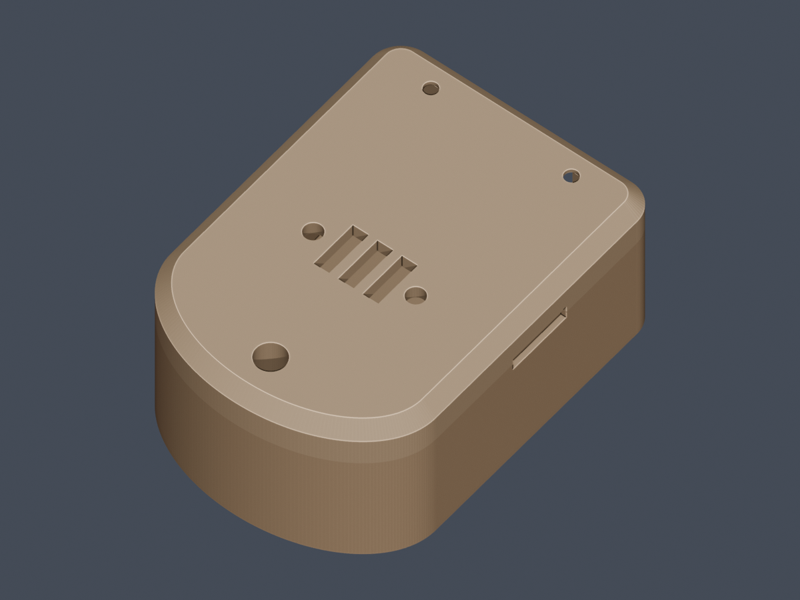
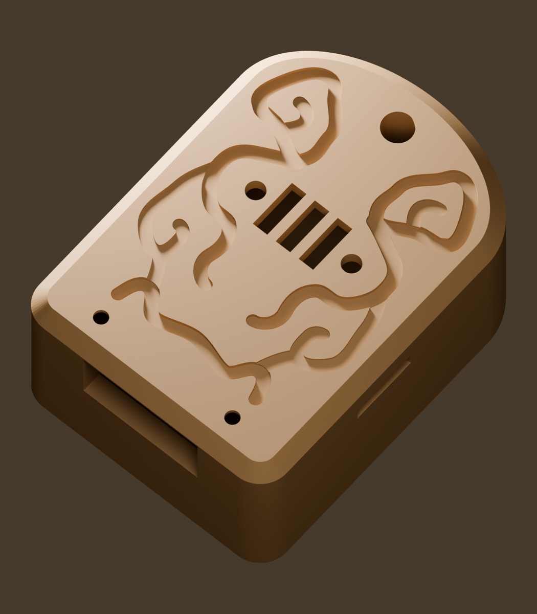

# Hark · 谛听

> An open-source wearable voice recorder (`DT-1`) that turns your spoken day into private, structured context for your own AI. Docs and UI are Chinese-first during the alpha.

> 谛听，伏地而听，辨万物之声。

Hark 是一个开源的随身语音采集器，硬件代号 **DT-1**，可以全天佩戴，也可以放在桌上。它把日常交谈转成文字，按「事件 · 时间 · 地点 · 人物」整理成个人上下文，供你自己的 AI 使用。

目前处于公开 alpha 阶段，手机端只支持 Android。

> **当前重心是手机端。** 我们在家里的 Mac 上跑本地 ASR，效果不理想，所以优先把「手机直连转写」做扎实。电脑端（桌面端、`hark-worker`）和盲信箱能用，但**还没经过高频使用**，可能有不少粗糙的地方。
>
> 遇到问题、有想法，欢迎[提 issue](https://github.com/riggedlab/hark/issues/new/choose)。

## 它怎么工作

```text
DT-1 ──蓝牙加密──▶ 手机 App ──端到端加密──▶ 盲信箱 ◀──拉取── 电脑端 ──▶ 语音转文字（ASR）
                                                              │
                                                              ▼
                                                     本地存档 ──▶ 你的 AI Agent
```

- **DT-1**：一块带麦克风的开发板，录音压缩成 Opus 后通过蓝牙加密发给手机。
- **手机 App**：负责接收、切段。可以直接在手机上转文字（推荐），也可以加密上传给电脑端处理。
- **盲信箱**（`server/`）：一个只转存密文的中转服务器。它没有密钥，自己解不开任何内容。
- **电脑端**：从信箱取回录音，在内存里解密，然后调用你配置的 ASR 服务转成文字，存进本机 SQLite。ASR 指语音转文字服务。
- **AI Agent**：通过 `hark` 命令行只读查询本地存档。

## 隐私与数据留存

| 环节 | 存什么 | 留存规则 |
|---|---|---|
| DT-1 设备 | 只有内存里 0.4 秒的预录缓冲，以及蓝牙配对密钥 | 不保存录音；加密连接建立之前不开麦 |
| 手机 | 录音（最近 7 天）、转写文字、地点记录 | 录音只留 7 天，处理完自动清理，没上传成功的不会删。**转写文字和地点记录会一直保留在手机上**，目前 App 里还没有删除入口，要清除只能在系统设置里清除 App 数据或卸载 App。地点记录不上传 |
| 盲信箱 | AES-256-GCM 密文 | 服务器不持有密钥。电脑端取回文字后，音频密文立即删除；没取走的音频最长留 7 天，文字密文最长留 30 天 |
| 电脑 | 本地 SQLite（`~/hark/hark.db`），保存文字存档和可选的声纹 | 音频只在内存里解密转写，磁盘上不出现明文录音；声纹只留在本机 |

> ⚠️ **录音前请征得在场其他人的同意**，并遵守当地关于录音的法律。

## 快速开始

### 1. 做一台 DT-1

需要一块 Seeed XIAO nRF54L15 Sense 和一块 402020 锂电池，焊两根线，装进 3D 打印外壳就行。外壳有两款，外形都是 23.7 × 32.8 × 15 mm：

| [简易款](enclosure/dt1-plain/) | [谛听款](enclosure/dt1-carved/) |
|:---:|:---:|
|  |  |
| 平面小牌，推荐黑色普通 PLA | 面盖阴刻谛听兽面纹，推荐木粉 PLA |

<sub>以上是渲染图，不是实物照片。两款都还没按最终文件重新打印验证。</sub>

- 物料、接线和装配：[docs/hardware.md](docs/hardware.md)
- 购物清单：[docs/shopping-list.md](docs/shopping-list.md)
- 外壳：[enclosure/](enclosure/)

> [!WARNING]
> **安全第一。动手前请完整读一遍[安全须知](docs/hardware.md#安全须知)。**
> - 这是需要自己焊锂电池的 DIY 设备，不是认证过的成品。锂电池短路、受压、过热都可能起火。
> - 前几次充电要有人在场，放在不可燃的台面上。不要边充电边戴着睡觉，不要给儿童佩戴。
> - 外壳装不进去时**不要硬按**。打印参数只是参考，请按你的打印机调整；打出来偏松或偏紧怎么办，见[尺寸与松紧](docs/hardware.md#尺寸与松紧)。

烧录固件前，需要先安装 nRF Connect SDK v3.4.2，详见 [firmware/README.md](firmware/README.md)：

```sh
./firmware/flash.sh recorder
```

### 2. 安装手机 App，用「手机直连转写」（推荐）

从 [Releases](https://github.com/riggedlab/hark/releases) 下载 `hark-*-android-arm64.apk` 安装，之后可以在 App 里检查更新、覆盖升级。

在 App 的「设备状态 → 转写与同步设置」里选择 **手机直连转写**，填上 ASR 服务即可，支持火山引擎豆包、OpenAI 兼容接口或自建 HTTP 服务。这样不需要信箱，也不需要电脑，手机直接出字，转写结果留在手机上。注意：录音会发给你配置的 ASR 服务商处理，想完全不出本机，只能用你自建的 HTTP 服务。

### 3. （可选）电脑端存档：盲信箱 + 电脑端

> 这条链路还没经过高频使用。

如果想把录音集中存到电脑上，或者让本机的 AI Agent 能查询，就切到 **云端信箱同步** 模式。录音会加密上传到盲信箱，再由电脑端统一转写存档。两种模式可以随时切换，各自的凭据都会保留。7 天内切回云端模式时，还没上传的录音会自动补传。

**① 部署盲信箱**：用 Docker 部署，或者直接下载 `hark-mailbox-linux-*` 单文件运行。详见 [server/README.md](server/README.md)。

```sh
cd server
cp .env.example .env   # 填入两个不同的随机字符串：PHONE_TOKEN、WORKER_TOKEN
docker compose up -d --build
```

**② 安装电脑端**：从 [Releases](https://github.com/riggedlab/hark/releases) 下载对应系统的桌面端，都支持自动更新：

| 系统 | 文件 |
|---|---|
| macOS（Apple Silicon / Intel） | `hark-*.dmg` |
| Windows | `hark-setup-*-amd64.exe` |
| Linux | `hark_*_amd64.deb` / `hark_*_arm64.deb` / `.tar.gz` |

装好后，打开桌面端，按顺序做三件事：

1. 在「信箱与存储」里点「生成新密钥」并保存。
2. 把密钥填到手机 App 的「服务器设置」。
3. 在「ASR 接入」里选一个服务商，然后点「测试连接」，确认能连上。ASR 服务的接入说明见 [docs/asr-guides/](docs/asr-guides/)。

不想开桌面端，也可以在 NAS 或 Linux 服务器上常驻运行无界面的 `hark-worker-*`：先运行 `-gen-key` 生成密钥，再直接运行，开始常驻拉取。

### 4. （可选）接入你的 AI Agent

需要先完成第 3 步：Agent 读的是电脑上的存档。

```sh
curl -fsSL https://raw.githubusercontent.com/riggedlab/hark/main/tools/install-cli.sh | sh   # 安装 hark 命令行
npx skills add riggedlab/hark -g -y                                                         # 给 Claude Code、Codex 等装技能
```

然后直接问它「我今天聊了什么」。Windows 安装方式、更新方法和完整命令见 [docs/cli.md](docs/cli.md)。

## 进度与计划

- [x] 固件 v1：16kHz 录音 → 80Hz 高通与固定 +12dB 增益 → Opus 压缩 → 蓝牙加密传输，静音时跳帧
- [x] Android：蓝牙配对重连、端侧人声检测、波形回放、事件/人物/地点时间线
- [x] 端到端加密盲信箱、跨平台桌面端、可插拔 ASR
- [x] DT-1 开发板版硬件方案与两款 3D 打印外壳（实测续航待补）
- [ ] iOS 原生客户端（复用同一套硬件和信箱协议）
- [ ] 蓝牙断连时，设备端先存到 Flash，之后补传
- [ ] 自制超薄 PCB v1

## 仓库结构

```text
firmware/      设备固件（C / Zephyr）
enclosure/     3D 打印外壳
android/       Android App（Kotlin / Compose）
server/        盲信箱（纯 Go 标准库）
desktop/       桌面端（Go + MyGo + Bun）
cmd/           hark 查询命令行、hark-worker
internal/      加密、信箱协议、ASR 适配、Worker 引擎
skills/hark/   本地 AI Agent 查询技能
docs/          硬件、ASR 接入、命令行、开发文档
```

## 反馈与参与

- **遇到问题、有建议**：请[提 issue](https://github.com/riggedlab/hark/issues/new/choose)。说明你用的是哪个组件、什么版本，以及怎么复现。**不要上传录音、转写内容、密钥或 `.env` 文件。**
- **硬件打印、装配的实物反馈**也非常欢迎，比如松紧是否合适、实测续航多久、整机多重。我们自己验证过的组合有限。
- **想改代码**：从源码构建、运行测试和发布版本的方法，见 [docs/development.md](docs/development.md)。

## 许可证

- 本项目主体采用 [MIT License](LICENSE)（Copyright (c) 2026 OWRIG）。
- `firmware/lib/opus`：[libopus](https://opus-codec.org/) v1.5.2，BSD License，见 `firmware/lib/opus/COPYING`。
- `android/app/src/main/assets/silero_vad.onnx`：[Silero VAD](https://github.com/snakers4/silero-vad)，MIT License。
- `firmware/blinky`、`firmware/ble-test` 改写自 Zephyr 示例，Apache-2.0 License。
