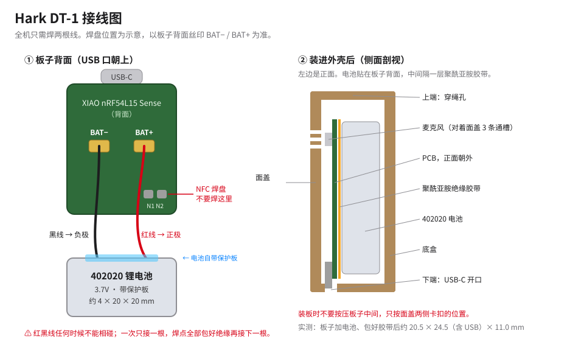

# Hark DT-1 硬件方案

DT-1 是 Hark 的第一代佩戴端：一块 Seeed XIAO nRF54L15 Sense 开发板，背面焊一块 402020 锂电池，装进 3D 打印外壳，用挂绳戴在身上。不需要画 PCB，只要焊两根线。

> 这是开发板验证版。自制超薄 PCB 还在调研，见 [hardware-pcb-notes.md](hardware-pcb-notes.md)。

> ⚠️ **动手前先读完「[安全须知](#安全须知)」。** 这是自己焊锂电池、自己装的 DIY 设备，不是认证过的成品。照着做的风险由你自己承担。

## 安全须知

### 锂电池

锂电池短路、被压、被扎破或过热，都可能鼓包、冒烟甚至起火。

- **只用带保护板的电池**，最好有 UN38.3 或 3C 认证。不要拆保护板，不要用来路不明的旧电池。
- **防短路**：电池的红线和黑线任何时候都不能碰在一起，也不能同时碰到镊子、剪刀这类金属工具。剪线、剥线时一次只处理一根，处理完的线头先用胶带或热缩管包住。
- **焊接要快**：烙铁头不要碰电池本体。每个焊点 2–3 秒内焊完；没焊好就先停下，等凉了再焊。
- **电池鼓了、凹了、漏液了、发烫了，就不要再用**。拆下来单独放在金属盒或陶瓷碗里，按当地规定交到电池回收点，不要扔进生活垃圾。
- **充电时要有人在场**：前几次充电全程看着，放在不可燃的台面上，远离床、沙发和纸张。不要盖着充电，也不要放在枕边过夜充电。
- **装壳不要压**：外壳内腔是按实测尺寸做的，余量很小。装不进去就停下来量，**不要硬按**。按压会压坏电池，也可能压坏板子。
- 不要放在暴晒的车里、暖气片上，也不要泡水。外壳不防水。

### 焊接

- 戴护目镜。焊锡和助焊剂可能飞溅。
- 开窗或开风扇，不要正对着焊接烟雾呼吸。
- 用无铅焊锡；焊完洗手，再吃东西。
- 烙铁用完放回烙铁架，断电以后再离开。

### 佩戴

- 戴着时如果外壳**发烫或闻到异味**，马上取下，并断开电池。
- 挂绳戴在脖子上有被勾住、勒住的风险。建议用受力会自动断开的安全扣，**不要给儿童佩戴**。
- 不要边充电边戴着睡觉。
- 外壳是 PLA，遇高温会软化，遇火能燃烧，不阻燃。

### 录音和隐私

DT-1 会录下身边所有人的声音，不只是你自己的。

- 很多地方的法律对录音有限制：录别人说话前要征得对方同意，有些场所禁止录音。用之前先了解当地规定。
- 和别人交谈时，**告诉对方你戴着录音设备**。对方不同意就关掉，也就是断开电池。
- 会议室、医院、考场、涉密场所等地方，按那里的规定，不要佩戴。

## 物料

| 部件 | 选型 | 数量 | 参考价 | 说明 |
|---|---|---|---|---|
| 主控板 | **Seeed XIAO nRF54L15 Sense** | 1 | ¥110–130 | 型号里必须有 **Sense**，不带 Sense 的没有麦克风。板上自带 PDM 数字麦克风、蓝牙、USB-C 充电、两个按键和两个指示灯 |
| 电池 | **402020 聚合物锂电池**，3.7V，**带保护板** | 1 | ¥10–15 | 约 4 × 20 × 20 mm，容量一般 120–150mAh，以电池标签为准。裸线或 1.25mm 插头都行 |
| 绝缘胶带 | 聚酰亚胺（Kapton）胶带 | 少量 | – | 隔开板子背面和电池，并把板子和电池包在一起 |
| 外壳 | 3D 打印，两种造型任选 | 1 套 | 几毛钱耗材 | 见下文「外壳」 |
| 挂绳 | 任意细绳 | 1 | – | 穿过外壳上端的穿绳孔 |

没有电源开关：电池接上就一直开机，关机只能断开电池。

焊接需要电烙铁、焊锡、助焊剂和万用表，新手清单见 [shopping-list.md](../shopping-list.md)。

## 接线

1. 先**不接电池**，用 USB 烧录固件并确认能正常工作（见 [firmware/README.md](../firmware/README.md)）。确认以后**拔掉 USB** 再焊电池。
2. 用万用表确认电池的正负极。不要只看线的颜色。
3. 先把两根线焊在板子背面的 BAT 焊盘上。USB 口朝上时，**左边 BAT− 接黑线（负极），右边 BAT+ 接红线（正极）**。右下角的 N1 / N2 是 NFC 焊盘，**不要焊在这里**。
4. 再接电池，**一次只接一根**：先接负极，包好绝缘，再接正极。电池本身带线的，一次只剪一根线，剪完马上包住线头。所有焊点都要用热缩管或聚酰亚胺胶带包好，不能露铜。
5. 接好后先别装壳。用万用表量 BAT 两端，应该在 3.7–4.2V；再打开 App，确认能连上板子并显示电量。如果冒烟、发烫，或者有焦味，马上断开电池。
6. 板子背面贴一层聚酰亚胺胶带，再把电池叠上去，最后整体包一圈胶带。
7. 包好后的实测尺寸约 **20.5 宽 × 24.5 长（含 USB）× 11.0 厚**（mm），外壳内腔按这个尺寸设计。

电池电压不用另外接线：板子自带 1/2 分压电路，接在 ADC 通道 7（P1.14），由 P1.15 控制只在测量时接通。固件每 30 秒读一次，通过蓝牙报给手机。

接上电池后，插 USB 就会充电，充电时红灯闪；不接电池时红灯常亮。

## 板载按键和灯

| 部件 | 作用 |
|---|---|
| 用户按键 | 短按打开 60 秒蓝牙配对窗口。板子只认配对过的手机 |
| 复位键 | 重启 |
| 绿灯 | 开麦时常亮；配对窗口内每 0.25 秒闪一次 |
| 红灯 | 充电指示 |

## 外壳

两种造型共用同一套内腔、卡扣和开孔，同一块装好电池的板子两款都能装：

| | 简易款 | 谛听款 |
|---|---|---|
| 目录 | [enclosure/dt1-plain](../enclosure/dt1-plain/) | [enclosure/dt1-carved](../enclosure/dt1-carved/) |
| 造型 | 平面小牌，没有图案 | 正面阴刻谛听兽面纹 |
| 推荐材料 | **黑色普通 PLA** | 木粉 PLA |
| 外形 | 23.7 × 32.8 × 15 mm | 同左 |

共同点：
- 面盖和底盒两件扣合。
- 上端有穿绳孔。
- 面盖上有麦克风 3 条通槽、两个按键孔、两个透光孔。
- 下端开 USB-C 口，装在壳里也能充电。
- 左右两侧有撬口，可以用卡片或指甲撬开。

打印：
- 用 Creality K3 和 0.4mm 喷嘴验证过。其他 FDM 打印机导入 STL 自己切片即可。
- 100% 填充，不用支撑。面盖正面朝下打，底盒背面朝下打。
- **不要用金属粉耗材**，金属会挡蓝牙信号。
- 木粉 PLA 的喷嘴温度用 205°C 左右，速度比普通 PLA 慢。打完不要让喷嘴在高温下空等，木粉容易碳化堵头。

装配：
- 板子正面朝面盖，USB 对准下端开口。
- **装板时不要按压板子中间**，只按面盖两侧卡扣的位置。放不进或盖不平就停下，量一下卡在哪里。我们坏过一块板子，怀疑是装进太紧的外壳时被压坏的，原因没有证实。

## 音频与无线

- 16kHz 采样，Opus 编码约 16kbps，实测每小时约 6MB。
- 安静时不发送音频，只发很小的「安静」标记。
- BLE 加密连接，广播名 `Hark DT-1`。手机完成配对、加密并订阅之后板子才开麦。

## 已验证与未验证

已验证：
- 麦克风、BLE、烧录；BLE 传输 0 丢包。
- 电池供电：拔掉 USB 后用电池录音传输正常。
- 简易款外壳实物试装：左右松紧合适。

还没验证：
- **续航**：一块 402020 能用多久还没测。
- 简易款第一次试装时面盖会前后滑。之后加了挡块、加宽了撬口，**改过的版本还没重新打印验证**。
- 谛听款还没打印过。
- 装进外壳后的收音效果，还没和裸板对比。
- 整机重量还没称，目标 ≤ 20g。
